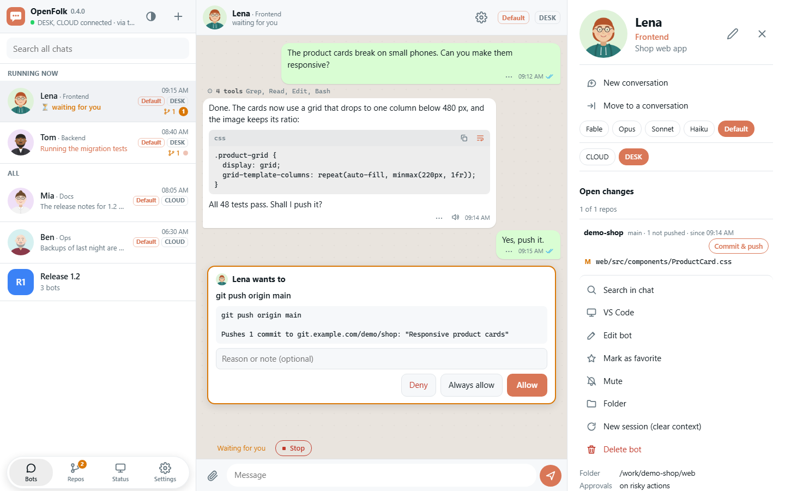
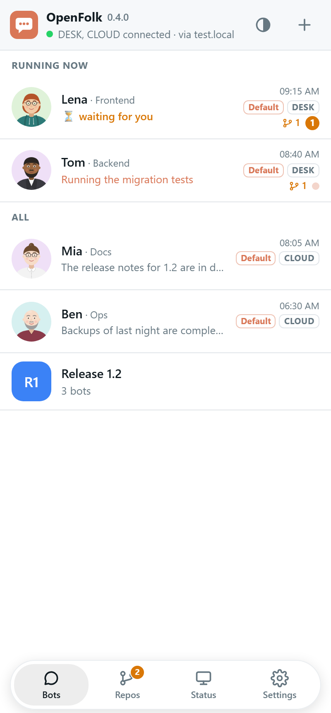
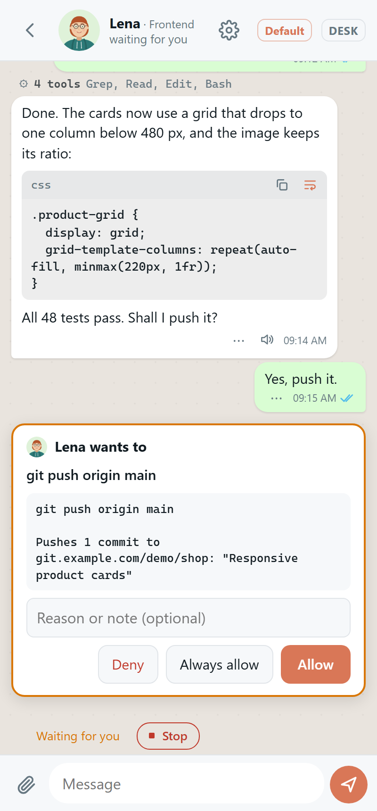
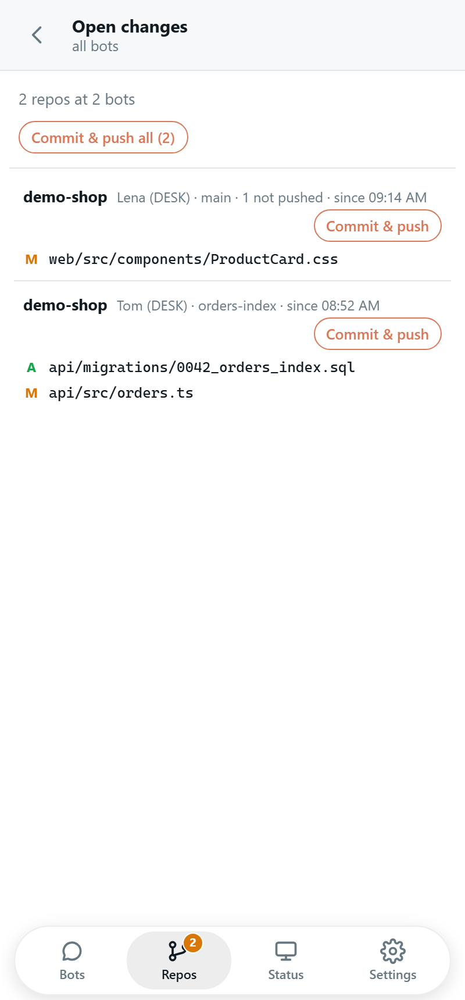
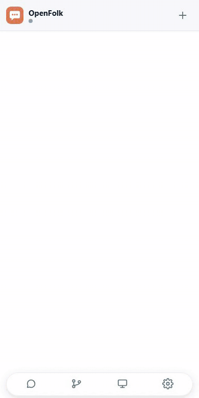
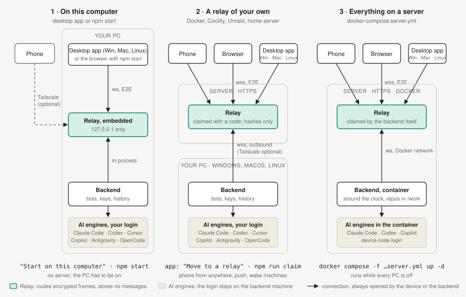

# OpenFolk

[](https://github.com/OpenFolk/OpenFolk/actions/workflows/ci.yml)
[](LICENSE)

A messenger-style web app (phone first) for running several AI coding agents on your own computers.
Every **bot** is a colleague with its own picture, name, role, tone and model, and works in a fixed folder,
for example one bot per repository. Bots keep working when the app is closed and notify you by push when they
are done or need an approval.

<picture>
  <source media="(prefers-color-scheme: dark)" srcset="docs/screenshots/desktop-dark.png">
  
</picture>

   

OpenFolk is not an IDE and is not built on one: at your desk you keep working in VS Code, Cursor or the terminal.
OpenFolk is a web app of its own that carries the same agents on when you are away from the machine, and hands a chat
back to the IDE when you ask.

Bots run on the **Claude Agent SDK** (Claude Code) by default. A bot or a single conversation can also use
**OpenAI Codex** or, through the Agent Client Protocol (ACP), **Cursor**, **GitHub Copilot**,
**Google Antigravity** or **OpenCode**. The UI is available in **English and German**.

Besides the browser (installable as PWA) there are desktop apps for Windows, Linux and macOS (Electron,
`desktop/`) and apps for iOS and Android (Capacitor, `mobile/`), all around the same web app.

<picture>
  <source media="(prefers-color-scheme: dark)" srcset="docs/architecture-dark.svg">
  
</picture>

The relay never sees model credentials and stores no messages. The backend connects outbound, so nothing has to
be opened on your router. End-to-end encryption is on from the first start, so the relay only sees routing
information. Optionally,
Tailscale restricts the backend connection further (`docs/tailscale.md`).

> **Status:** early open-source release. The backend is developed and tested on **Windows 11** and runs as a
> Linux container (`docs/running.md`). Machine control is configurable (same page, "Machine settings"): waking
> via Wake-on-LAN, a wake service or your own command, shutting down on Windows, macOS and Linux. A woken machine
> runs its bots without anyone signing in on Windows and Linux; a Mac needs a sign-in, and the automatic sign-in
> of the desktop session is Windows-only. The relay runs anywhere Node 22 or Docker runs.

**Try it in two minutes:** install the desktop app from the [releases](https://github.com/OpenFolk/OpenFolk/releases)
(Windows, macOS, Linux) and choose "Start on this computer", or from source with Node 22:

```sh
git clone https://github.com/OpenFolk/OpenFolk.git openfolk && cd openfolk && npm install && npm start
```

The app opens in the browser, walks you through signing in to Claude Code and creating the first bot, and pairs your
phone with a QR code. Everything else is in [Getting started](#getting-started).

## Features

- **Bots and templates.** Create a bot with "+", optionally from a template. The default, "Set up in the chat", needs
  only a name and a folder: the bot looks at the folder, asks a few questions with options in its chat and fills in
  field of work, role and working instructions itself (`set_profile`); a bot from another template skips what that set.
  Its chat opens right after saving; everything stays editable in its settings. Per bot: folder, model (default,
  Opus, Sonnet, Haiku, Codex, Cursor, Copilot, Antigravity, OpenCode or a custom id), approval level, tone and the
  voice that reads its answers aloud (guessed from the name unless chosen): male or female, and a voice of its own of
  the provider reading right now (OpenAI's 13, Gemini's 30, Piper's per language) with "Listen" for a sample.
  "AI avatar" opens a set of ready-made portraits (drawn, in `webapp/avatars/`; `npm run avatar-set` redraws them) with
  the image model as the last entry.
  "Suggest" proposes names (a first name with a field of work, kept in a field of its own), a role or a profile
  picture from the folder's README/CLAUDE.md; with
  a Gemini or OpenAI key in the settings the avatar is a generated photo, otherwise an SVG drawn by the model. The field
  "Folder or repository" is a text field: the folder has to exist on the bot's machine and lie under that machine's
  allowed folders (`docs/running.md`, "Allowed folders"), otherwise the backend refuses it with the reason. A git
  repository's address instead of a folder makes the backend clone it into the machine's folder for bots on save;
  "Browse" lists the folders of the bot's machine and creates a new one there. A bot without a project of its own
  (research, brainstorming) leaves both empty and gets a folder named after it in the folder for bots.
- **Approvals in the chat.** Per bot: *risky* (default) asks before deleting, pushing, deploying, SSH, service
  restarts, writing outside the folder or into secrets, reading secrets through the shell, installing packages,
  running code from the internet (`curl … | sh`), elevated rights and every call of an external MCP service, reading
  ones included; it checks every part of a shell command (`a && b | c`) on its own. It is a careful filter, not a
  fence: a script the bot writes and then runs is not looked into. Whoever wants every command confirmed uses
  *write*, which asks before every change; *never* never asks. Reading tools never get `.env` files or keys,
  whatever the level. The card offers allow, always allow (for the session), always for this bot (external MCP tools;
  the bot editor lists them and takes them off again) and deny with a reason; unanswered requests are denied after
  30 minutes. Rules: `local/src/policy.ts`.
- **Connectors.** The services connected in the claude.ai account Claude Code is signed in with (Gmail, Drive and
  so on) stay out of the bots' sessions unless the machine settings let them in ("Connectors"). MCP servers you
  configure yourself (`.mcp.json`, `claude mcp add`) are not affected.
- **Questions.** Multiple-choice questions of a bot (AskUserQuestion) appear as a card with buttons and free text.
- **Push notifications.** Per kind (bot done, routine done, approval/question, machine awake, usage limit, message from a person, hand-over) off,
  quiet, normal or high, for all devices. Single bots and groups are muted on their page or in the list's menu. Sent directly from your machine:
  Web Push/VAPID to browsers (on iPhone only from the installed PWA), APNs and FCM to the mobile apps
  (`mobile/README.md`).
- **Activity.** Tool calls as expandable rows with result and duration; the list shows what a bot is working on.
- **Usage.** Five-hour and weekly window of the subscription; Codex limits are shown separately.
- **Routines.** Scheduled prompts (daily, weekdays, weekly, hourly or cron) with "run now". A routine can wake
  its machine (`docs/running.md`, "Machine settings") and shut it down afterwards.
- **Slash commands.** In a bot's chat on Claude, "/" at the start of a message lists Claude Code's commands for the
  bot's folder: your own (`~/.claude/commands`, skills), the project's (`.claude/commands`), plugins' and a few
  built-in ones such as `/compact` and `/context`. Claude Code runs them as in the terminal. A message that starts
  with `/name` goes to the bot exactly as typed, without the quote or group note OpenFolk otherwise puts in front, so
  this also works in groups and in routines. Codex and the other engines get no list.
- **Group chats.** Several bots in one chat; `@id` addresses one bot, `@all` everyone. Bots can hand over to
  each other with @ (up to four hops per message).
- **Folders.** "+" → "New folder" adds a folder to the chat list; a bot or group goes into one from its menu
  ("Folder") or its settings. A tap on the heading folds the folder, a long press renames or deletes it. Running
  bots and unread answers sit at the top of the list meanwhile, whatever folder they are in; folders sync like bots.
- **Bot to bot.** With `message_bot`, `list_bots` and `list_conversations` a bot gives another bot a job, or a
  specific conversation (also another one of its own, say from brainstorming to coding), also on another machine.
  The call returns at once, and the result comes back into the conversation that gave the job by itself, however
  long it takes: the bot there carries on with it and you get a notification. A bar above the input says whom the
  chat waits for since when; a tap opens that chat, and "Stop waiting" or "Cancel job" end it. Open jobs survive a
  restart, a job to a sleeping machine goes out once it wakes, and a result for a sleeping machine waits on the
  target's machine. Loops are refused. Which bots a bot can reach is set in its settings under "Can give jobs to"
  (all, selected or none, each with all its conversations); group chats are not limited by it.
- **Chats with people.** "+" → "Person" opens a chat with someone on the same relay, a team member or a customer
  (see Accounts). Text, files and voice messages go both ways, with notifications, unread, favorite, mute and search
  like any chat. A bot with "Hand over to" set in its settings gets the tool `hand_over`: it sends that person its
  summary, they get a notification, and the user gets a "Continue with …" button in the bot's chat. Bots do not read
  the chats between people.
- **Files.** Attach, paste or drop files; images and PDFs go straight to the model. Bots send files with
  `send_file`. Secrets (`.env`, keys) and the backend's data are never handed out. Asked to, a bot sets its own
  profile picture from an image in its folder with `set_avatar` (PNG, JPEG, WebP or GIF up to 300 KB) or makes one with
  `make_avatar` like the editor's "AI avatar" (a photo with the image model's key, else a drawn portrait); its chat says
  so, and the editor puts another one back.
- **Knowledge.** Bots build a memory of single facts with `remember_fact` and related tools, scoped to the bot,
  its folder, a group or everyone. Only an index goes into the system prompt; the bot reads the full text on demand.
  With `search_history` and `read_history` bots also search the earlier messages of all chats on their machine
  (never the tools' output), so "what did we decide about the deploy?" gets answered from the conversation where
  it was decided. Other knowledge (wiki, Notion, Confluence) comes in through the MCP servers you connect.
- **Voice messages.** Recorded in the browser, transcribed locally with faster-whisper on the machine that runs
  the bot (`local/tools/transcribe.py`; model and language in the settings). This is the only part in Python and optional:
  with Python 3.9 or newer on the machine, "Set up voice messages" in its settings installs the rest
  (`local/tools/requirements-voice.txt`, also by hand), with the CUDA libraries where there is an NVIDIA card, and
  loads the model: about 1.6 GB for the default `large-v3-turbo` (without a graphics card `small`, about 0.5 GB). A
  Python that has faster-whisper already is used as it is. The same environment reads answers aloud with Piper
  (`local/tools/speak.py`): free and offline, a male and a female voice per language (German: Thorsten and Kerstin),
  loaded by the setup or with the first use; a little flatter than the cloud voices.
- **Voice conversation.** The button next to the microphone opens a page where you talk with a bot hands-free: the
  recording goes out by itself after a pause, the transcript and what the bot is doing are shown, the answer is read
  aloud (what the bot says before a tool runs right away) and the microphone opens again. A tap on the picture sends
  at once or stops the voice; the bot is asked to answer briefly, in spoken language. The page keeps the screen on
  where the browser allows it; in the background it pauses and reads a waiting answer when you come back. Bot chats
  only, and it needs voice messages set up on the bot's machine.
  With "OpenAI Realtime" in the settings (and an OpenAI key) the conversation runs like ChatGPT's instead: OpenAI's
  `gpt-realtime-2.1` (or the cheaper mini) listens, notices the end of a sentence and lets you interrupt; it passes
  every request on to the bot and speaks the bot's answer. Your voice then goes to OpenAI and costs a few cents a
  minute; the key stays on the machine, which opens the connection.
- **Read state, favorites, pinned messages** are synced across all devices and machines.
- **Columns on wide screens.** Ctrl-click (or the middle button) opens a chat in a column of its own next to the
  others, as many as fit (one per 640 px); "+" at the right edge adds an empty one. With the mouse a chat can also
  be dragged from the list onto a column or onto "+". Every column has its own input,
  queue and search. The bot info docks as a column of its own. Phones and laptops keep one chat.
- **Tabs.** Floating at the bottom of the list: Bots, Repos (open changes of all bots, with a badge), Status
  (the machines with their bots, engines and backend, waking and shutting down, the plans' quota with the 5-hour and weekly windows, a separate one for Fable, and when
  each resets) and Settings.
- **Open changes.** Uncommitted files and unpushed or unpulled commits of the git repos in a bot's folder, with
  commit-and-push or pull per repo. The backend also reports when it runs outdated code and offers a gentle restart.
  Pushing needs credentials the backend reaches without a terminal (`docs/running.md`, "Git access").
- **Repos stay current.** On start, after waking, every quarter hour and when another machine pushes from the app,
  the backend fetches the repos of its bots and fast-forwards those without local changes or commits of their own.
  It never merges, rebases or resets, and leaves a repo alone while a bot works in it; what it cannot take over shows
  in "Open changes" with the reason. A switch in the settings turns it off.
- **VS Code and terminal.** Lists sessions you ran in VS Code or with `claude` in the terminal in the bot's
  folder, follows them live and branches them into a conversation. "Machine sessions" in the "+" menu lists them
  for every folder of each awake machine, newest first; "Continue here" there takes the bot whose folder holds the
  session. Codex threads from its VS Code extension and CLI are listed too; continuing one runs the conversation on
  Codex and needs the ChatGPT sign-in (with an API key the bots keep their threads apart). Cursor, Copilot,
  Antigravity and OpenCode have no list of their sessions to read. The other way round, "Open this chat in the IDE"
  and "… in a terminal" above that list hand a chat's session to its machine: by default VS Code with Claude Code for
  VS Code, or a terminal with `claude --resume`; `HANDOVER_IDE` and `HANDOVER_TERMINAL` set other commands, the
  settings of the machine turn either off. A backend
  without a desktop (a Windows task in session 0, a Linux service) cannot open windows; the desktop app, running in the
  signed-in session of that machine, opens them for it.
- **Several machines.** The same backend runs on every machine; bots exist once. Every bot lives on one machine
  and works in a folder there; while that machine sleeps, the bot sleeps and the app offers to wake it. Every machine
  has a folder for bots (its settings, "Folder for bots"; the first allowed folder unless chosen), and a bot's machine
  writes down where the bot lives below it, with its repository. Moving a bot is a tap on the other machine on the
  bot's page, nothing else: the bot goes to the same place below that machine's folder for bots, the repository is
  cloned there if it is missing, a folder without one is created, a sleeping machine is woken for it, and the sessions
  come along with full context. Only when that place is taken by something else, or the folder lies outside the
  allowed folders, the app asks for folder and repository. Work that is not on the git server yet (uncommitted changes,
  new files, unpushed commits) comes along by itself, end-to-end encrypted through the relay, without a push; the new machine applies
  what fits cleanly and parks the rest in the repo's `.git/openfolk-work/`.
- **Settings.** Language, theme, notifications, devices and security; per device whether the answer to a voice
  message is read aloud by itself once it is done (on by default). Shared by all machines: the AI services (the API
  keys of OpenAI and Google Gemini as a list), the image model for profile pictures, how the voice conversation runs (in the app or over OpenAI Realtime), the voice for reading answers aloud (with one of those keys an OpenAI or Gemini
  voice, else the bot's machine where voice messages are set up, otherwise the device's own; with a cloud voice the text goes to that provider), the language of voice messages, what app
  notifications show, keeping the repos current. Per machine (main account only): the AI providers that run there, each on its subscription or a key,
  shutting down with its countdown and
  what happens after wake routines, automatic sign-in, "Open in the IDE / in a terminal", the speech model. A browser
  only learns whether a key is stored; keys travel to the other machines only end-to-end encrypted. What runs
  commands or draws a security line (scripts, commands, allowed folders) stays in the `.env`. "About" at the end lists
  the desktop app's version, the web app's protocol version and, per connected backend, its protocol version and start;
  software versions of backend and relay do not reach the app.

## Layout

```
openfolk/
├── shared/protocol.ts   frames web app ↔ relay ↔ backend, PROTOCOL_VERSION
├── local/               backend on your machine (Node 22 runs the TypeScript itself)
│   ├── src/agent.ts     bot management: frames, groups, approvals, routines, push
│   ├── src/bot-tools.ts the bots' own tools: other bots, files, knowledge, history
│   ├── src/frames.ts    checks every frame of a web app or app before the backend acts on it
│   ├── src/push*.ts     Web Push, APNs (iOS) and FCM (Android)
│   ├── src/session.ts   one session per bot: queue, approval hook, tool results
│   ├── src/codex.ts     OpenAI Codex engine; src/acp.ts ACP engines (Cursor, Copilot, Antigravity, OpenCode)
│   ├── src/i18n.ts      backend texts in English and German
│   ├── src/migrate.ts   upgrades stored data on start
│   ├── tools/           commands for users: pairing, claim, engine sign-in, voice, the Windows task
│   └── data/            not versioned: bots, groups, routines, history, knowledge, uploads, keys
├── relay/               relay server and Dockerfile (compiled with tsc for the image)
├── webapp/              UI without build step (ES modules in js/, i18n/*.js, chat.css, PWA)
├── desktop/             desktop app (Electron) for Windows, Linux and macOS around the web app
├── mobile/              iOS and Android apps (Capacitor) with the web app inside
├── deploy/unraid/       Unraid template for the relay
├── tests/browser/       Playwright tests of the web app against a scripted relay and backend
├── scripts/             test runner, desktop bundle and smoke test, screenshots, a WebSocket test client
├── wake-agent/          one file for a Raspberry Pi at home that wakes the machines for a relay on a server
├── docs/                running.md, tailscale.md, README.de.md, architecture.svg, internals/ (architecture decisions)
└── AGENTS.md            read first when changing OpenFolk
```

The web app consists of ES modules in `webapp/js/` without a build step. `js/main.js` loads them all; `start.js`
(wiring events, start) runs last because no other module may import it, and code that runs at load time belongs
there only (`docs/internals/web-app.md`). Everything that
differs between browser, desktop and mobile apps (relay address, push, key storage, saving files, icon badge)
goes through `js/platform.js`. The modules are plain JavaScript with JSDoc types, checked by `npm run typecheck`
(`webapp/tsconfig.json`). UI texts live in `webapp/i18n/en.js` and `webapp/i18n/de.js` (same keys).

App, web app and backends update at different times, the mobile apps through the stores. `PROTOCOL_VERSION`
in `shared/protocol.ts` (with a copy in `webapp/js/core.js`) is raised with every change the other side cannot
ignore; the web app compares it with what the backends report and says which side needs an update. Backends
check incoming frames with Zod (`local/src/frames.ts`) and answer malformed ones with an error.

## Requirements

- Node 22.18 or newer and npm (not for the desktop apps, which bring their own).
- Claude Code CLI signed in with your subscription (run `claude` once), or an Anthropic API key in the settings of
  the machine. Please respect Anthropic's terms for subscription use; for automated or shared use the
  API key mode is the safe choice.
- Every provider signs in either with its subscription or with a key stored in the machine's settings under "AI
  providers": an OpenAI API key for Codex, a Cursor API key, a GitHub token with Copilot access, a Gemini API key for
  Antigravity. Keys from the environment (`OPENAI_API_KEY`, `GH_TOKEN`, `GEMINI_API_KEY`, …) are never passed to
  an engine. With its key Codex keeps a folder of its own in the data folder, so the ChatGPT login stays for
  switching back; Codex chats started before a switch begin a new thread. Providers switched off there are not
  started on that machine; a new installation starts with all of them off until you pick yours in the first steps.
- Claude can also run on both: "Subscription and API key, by rules" uses the subscription until it reports its limit
  (or already Anthropic's warning before it), then the API key until the limit resets, at most up to a daily cap in
  US dollars. The turn the limit stopped runs again on the key. The other engines do not report their limit before a
  turn fails (Codex would also lose the thread on every switch), so they choose one of the two.
- Optional: Codex (`npx codex login`, ChatGPT subscription), Cursor CLI (`agent login`), Copilot
  (`npx copilot login`), Antigravity (`node local/tools/acp-install.mjs antigravity-acp`), OpenCode (free models
  without login, the providers may train on the data; other providers via `npx opencode auth login`; API keys in the
  environment are never passed to it). An engine appears in the model list once its login is present; restart the
  backend afterwards. The Codex, Copilot and OpenCode CLIs come as optional npm dependencies (about 750 MB); `npm install --omit=optional` leaves them out for Claude-only use.
- Optional: a host for the relay with HTTPS (any Docker host, e.g. Coolify, Fly, a VPS behind a reverse proxy),
  for your phone from anywhere and for several machines. Without one the relay runs inside the backend. The relay
  alone fits on the smallest VPS; with a backend in a container next to it take at least 2 GB of memory and 10 GB
  of disk (`docs/running.md`, "Server size").
- Optional for transcribing voice messages: Python 3.9 or newer; the app's settings set up the rest.
- Optional for the mobile apps: Android Studio and/or Xcode, see `mobile/README.md`.

## Getting started

The desktop apps for Windows, Linux (AppImage, .deb) and macOS bring the backend along: choose "Start on this computer" on
their first start, sign in to Claude Code when the app asks, and that is all (`desktop/README.md`). They come from
the [releases](https://github.com/OpenFolk/OpenFolk/releases) and update themselves from there. Their first update check
of a day is counted anonymously on openfolk.app (a daily total per system and version, no IP, no identifier, public at
[openfolk.app/update/stats.json](https://openfolk.app/update/stats.json)); the app's menu switches that off. From source:

```sh
git clone https://github.com/OpenFolk/OpenFolk.git openfolk
cd openfolk
npm install
npm start
```

That is the whole setup on one computer. Without a `.env` the backend runs the relay inside its own process on
`http://127.0.0.1:8787`, generates every key on its first start (`local/data/`) and opens the web app in the browser
with a pairing link, which signs the browser in and hands it the end-to-end key. The app then walks you through the
first steps: whether a backend is connected, which AI providers it runs (a new installation starts with none, you
tick your own) and whether it is signed in to one (Claude Code in a terminal the app opens on that computer, or
with an Anthropic API key typed into the step; Codex and Copilot with a device code that you enter on any device),
the first bot and the pairing of your phone. Each step ticks itself off.
`?chat=<id>` opens a chat directly. The UI follows the device's language: German on German devices, English
everywhere else; change it in the settings.

```sh
npm run pair                               # pairing link and QR code for one more browser or phone (15 minutes, once)
node local/tools/e2e.mjs password          # the web app's password, only needed without a pairing link
npm run cli -- --new /path/to/project "Helper"   # create a bot in the terminal
npm run cli -- helper                            # chat in the terminal; /new, /stop, /exit
```

The pairing link carries the end-to-end key, so the backend shows it only in an interactive terminal, never in a
log file; started as a service or container it prints how to get one instead.

### Which setup fits

| You want | Setup | Section |
| --- | --- | --- |
| to try it, or work at this computer only | the desktop app ("Start on this computer") or `npm start` | above |
| your phone from anywhere, push, waking sleeping machines | a relay of your own on a server, the backend on your PC | `docs/running.md` |
| bots that run while your PCs are off | relay and backend together on a server (`docker-compose.server.yml`) | `docs/running.md` |

Every setup keeps the same rule: the relay only passes encrypted frames through. Sessions, history and the logins
of the AI providers stay on the machines that run the backend.

## Running it permanently

For your phone from anywhere, push and machines that wake for their routines, run a relay of your own on a server
(`ghcr.io/openfolk/openfolk`, Docker Compose, Coolify, Unraid) and claim it with the setup code from its log: in the
app (first steps, or settings → "Devices and security" → "Move to a relay on a server"), where the backend moves over
and the page follows it, signed in there; or in the terminal with `npm run claim`. The desktop app joins a computer to
that relay with the link from "Add machine" ("Connect this computer to my server"), or by a QR code on its setup page
that a signed-in phone scans, and, on Windows and Linux, runs its backend
without signing in ("Run without signing in" in the tray menu). Backends from a checkout start with their machine (a
scheduled task on Windows, a systemd user service on Linux) or run as a container that never sleeps (`ghcr.io/openfolk/openfolk-local`);
`docker-compose.server.yml` puts relay and backend on one server (`docker-compose.coolify.yml` in Coolify), and its
first device signs in with the code the backend prints to its log, or with one set beforehand (`FIRST_DEVICE_CODE`)
for someone who starts with nothing but a phone. Waking (Wake-on-LAN, your own command, a wake service) is set on the relay, shutting down
and restarting on each backend.

All of it, step by step: [docs/running.md](docs/running.md), in German with a five-step guide for a relay of your
own in [docs/README.de.md](docs/README.de.md) ("Dauerbetrieb"). The `npm run …` commands there belong to a checkout
of the source; the desktop app does each of those steps in its own interface (the relay from the settings, devices
and machines from the settings, restart and "Run without signing in" from the tray) and keeps its `.env` in the app's
profile folder. Which folders bots may use (`ALLOWED_ROOTS`) and how git pushes without anyone to answer a prompt
(tokens, SSH keys) are explained there too.

## Accounts

One relay and its machines can serve several people or roles: you at work and at home, a colleague, one account
per customer. Each account has its own bots, chats, knowledge, devices and its own sign-ins to Claude and Codex, so
subscriptions, limits and usage stay apart, and of the others it sees only the names and the chats with them. Whoever set up the relay owns the
main account; nothing changes until a second one exists.

- **One list, one "Add":** settings → Accounts is one list grouped by relay: every account this device is signed in to
  (the active one marked, the others with switch and remove) and, for an admin, everyone else on this relay with
  "Create invitation link", admin and delete. One button "Add" takes whatever you were given: an invitation into an
  account, a pairing link of another relay, or just a relay's address (then it asks for account and password); an
  admin also creates a new person there ("Create account and invitation link"). The invitation is a pairing link with
  a QR code, valid for 15 minutes; whoever opens it is signed in to the new account and may set a password of their own
  afterwards. The main account always is an admin.
- **Order when inviting:** the invitation signs the person's device in to the new account at once, and there the
  setup checklist waits with the Claude sign-in for that account (a command for a terminal on the machine, see below),
  which cannot be done on a phone. So create the account first and open the invitation on your own PC (a signed-in
  device joins the new account that way), do the sign-in there for every machine whose bots the person should use,
  and only then create a new invitation for the person in the list of accounts. They open the link or scan the code
  on their device and find a finished account. Link and QR code are the same invitation and work once: open the link
  or scan the code, not both.
- **Switching:** the name next to the title in the sidebar names the active account and switches between the
  accounts and relays of this device; an invitation link opened on a signed-in device adds its account too.
- **Signing out:** "Sign out" in that menu (or at the very bottom of the settings) leads to a choice of the accounts on this device;
  a tap signs in again without a password, "Sign in with another account" opens the form. An account not used as the
  active one for 30 days loses its key on this device and asks for its password again. The "⋮" menu of a row forgets
  the account on this device. An admin creates a new account from the same menu or the choice ("New account"), and
  this device is signed in to it at once. Signing a device out for good stays under "Devices and security".
- **One list:** the chat list shows the bots of every account the device is signed in to, those of the other
  accounts with the account's name as a badge (the active account's without), with what they do, their last message and what is new. A tap opens
  the chat in its account; notifications of every account arrive. "Show all accounts in one list" under Accounts
  turns it off for this device, then the list shows the active account only.
- **Several relays (the apps):** "Add" with a pairing link from another relay signs the app in there, for example
  one relay per customer. Each relay keeps its own machines, accounts, devices and key. The chat list shows the bots
  of all of them with the relay's name as a badge. In the browser the page belongs to one relay; further relays are
  kept as links there.
- **AI sign-ins per account:** the main account uses the machine's own `~/.claude` and `~/.codex`. Any other account
  signs in once per machine into its own folder: Codex with a code from the setup checklist, Claude with the command
  the checklist shows (`CLAUDE_CONFIG_DIR=… claude`). Copilot, Cursor, Antigravity and OpenCode serve the main account only, as
  they cannot keep a second sign-in apart, and a machine's API key is the main account's key only.
- **What stays with the owner:** the settings of a machine, shutting machines down or restarting them, automatic sign-in and the VS Code
  sessions belong to the main account. Bots of every account work in the folders under `ALLOWED_ROOTS` of the
  machine they live on.
- **Deleting:** an admin deletes an account in the same list. Its devices are signed out at once; on every machine
  its data goes to `local/data/deleted-accounts/`, so a mistake can be undone there.
- **Chats between accounts:** every account can write to the other accounts on its relay ("+" → "Person"). A customer
  should reach their team and no other customer: tick "Customer: chats with the admins only" when creating the account,
  or choose "Admins only" or "Reaches everyone" in the list later. Admins reach everyone. An account that only chats needs
  no Claude sign-in; while it has no bots, the app shows it the people it can write to instead of the checklist. Each
  side keeps its own copy: deleting the chat deletes one's own. A customer's support bot hands over to you when your
  account is set under "Hand over to" in its settings.

### Setting a person up on their own computer

An employee or customer can run their bots on their own computer, with their own Claude subscription, while you set
those bots up from your OpenFolk. They install the desktop app (Windows or macOS) and sign in to Claude there; you
prepare everything and send them one link.

1. **Prepare:** create an account for the person (settings → Accounts → "Add"), then "Set up" in its row. Choose the
   bots: a support bot that only reads (level "only reads", it answers questions about the project from the code
   and changes nothing) and a development bot that changes the project and pushes, each with the https address of
   the repository and a token of its own for it (read-only for the support bot). Tick whom the person can write to
   (you and further team members) and whom the bots hand a conversation over to. Save.
2. **Link:** "Make setup link" gives a link valid for 7 days, once; a new one replaces it, "Revoke link" ends it. It
   carries the key of your chats, so send it only to that person.
3. **The person opens it:** the relay's page has "Open in OpenFolk"; the desktop app asks once and then joins your
   relay as a machine bound to that account. It clones each repository into a folder of its own with its token and
   makes the bots. The person sees their bots and the people they may write to, nothing else.

What the binding means: a machine joined by a setup link serves only its account, and that account runs only on such
machines. Your bots, chats and machines never reach it, and its chats do not reach your machines: person chats and
the setup travel between the machines through the relay, which stores nothing (a message waits on the sending
machine until the other one is online, for up to a week). The person cannot change or delete the bots of the setup;
you change them in the same dialog, and the change reaches their computer the next time it is online. The tokens lie
in the account's data on their computer, outside the bots' folders, in files the bots' tools refuse; still, a write
token is on their computer, so give each person a token of their own for that one repository. A support bot's clone
follows the repository: it fetches and fast-forwards before answering, at most every five minutes.

The way back: deleting the account logs its computer out, and its data there goes to `deleted-accounts/` like on every machine; the person can use "Disconnect
from …" in the app's File menu, after which the app runs on their computer alone again. A setup link only goes into an
OpenFolk that is new: one with bots of its own, or joined to a relay, refuses it with the reason.

## Security

What the host of the relay can and cannot do, with end-to-end encryption on (the default):

| The relay host can | The relay host cannot |
| --- | --- |
| see which devices and machines are connected, when, from which IP address | read chats, files, history or knowledge |
| see the size and timing of encrypted frames | send a frame of its own to a backend, or deliver a recorded one again |
| refuse to pass frames on, or serve manipulated JavaScript to browsers (not to the mobile apps) | use your model subscriptions or API keys, which never leave your machines |
| see the preview of app notifications it delivers for backends without Apple or Google credentials | sign in a new device without the password, a pairing link or, if set, the TOTP code |

- **Transport and relay:** HTTPS/WSS. The relay stores no messages and serves the UI with a strict Content
  Security Policy, `X-Frame-Options`, `nosniff`, `no-referrer` and HSTS.
- **Sign-in per device:** the password (`USER_PASSWORD`) is entered once per device; afterwards the device uses its
  own key, the relay keeps only a hash. Devices can be logged out individually; every new sign-in triggers a push.
  Optional TOTP. Failed attempts are rate limited.
- **Pairing links:** a signed-in device creates a link for the next one (settings, "Devices and security", "Pair another device";
  or `npm run pair` in the terminal). It signs the device in once without the password, works for
  15 minutes and carries the end-to-end key behind `#`, which browsers never send to a server. Open it on the new
  device or scan the QR code: "Scan QR code" on the sign-in page reads it with the camera (the mobile app's native
  scanner, the browser and the desktop app through the camera of the device); the mobile app also takes it pasted
  into the address field.
- **QR sign-in the other way round:** the sign-in page of a device that is not signed in shows a QR code of its own.
  A signed-in device scans it (camera app, or settings → "Devices and security" → "Scan QR code"), shows the new
  device's name and address for confirmation and then hands it a pairing link sealed for a key that only travels in
  the QR code. Handy for laptops and desktops without a usable camera.
- **Backends:** `AGENT_TOKEN` plus machine name; a second connection under a name that is connected and responding
  is rejected, and reported when it comes from another address (from the same one it is a restart overlapping its
  predecessor, such as a container being redeployed).
- **End-to-end encryption:** all frames between browser and backend and the sync between backends are encrypted
  with AES-256-GCM. Without `E2E_KEY` the backend generates the key on its first start (`local/data/e2e-key`);
  every further machine needs the same value as `E2E_KEY` ("Add machine" in the settings hands it over with the
  invitation), and each device gets it through a pairing link
  (`npm run pair`, link and QR code). Every frame carries a counter and its sending time, so a
  relay that records frames cannot deliver them a second time; with the key on a device, the app ignores unencrypted
  frames apart from the relay's own. `E2E_KEY=off` switches the encryption off, then the relay host can read every
  chat. Limitation: whoever controls the relay could serve manipulated JavaScript; the mobile apps bring the web app
  along and are not affected by that. They keep the key in the iOS Keychain or the Android Keystore.
- **Files:** the app downloads files only from the bots' folders and the uploads, never secrets (`.env`, keys), the
  backend's data or the dot folders under your home folder (the CLIs' logins). A bot's folder is checked against
  `ALLOWED_ROOTS` of the machine that runs it, before every job; links and junctions are resolved first.
- **Bot text** is rendered as Markdown and sanitized: no scripts, no styles, no classes, no `data-` attributes, so
  a bot cannot draw its text as one of your messages or as a button of the app.
- **Push to the mobile apps** is not end-to-end encrypted: Apple and Google see what a notification contains.
  The setting "App notifications show" limits it to the title (default; it names the bot, the group or the machine) or
  nothing but "OpenFolk". A relay with Apple and Google
  credentials delivers for backends that have none; it then sees that preview too and nothing else. That is the
  only case in which the relay sees any content (`docs/internals/push.md`).
- Report vulnerabilities privately, not in public issues.

## Development

```powershell
npm run typecheck     # tsc for local, relay and the web app (JSDoc, checkJs)
npm run lint          # oxlint over backend, relay, web app and tests
npm test              # backend, relay and browser tests (Playwright, no model calls)
npm run check         # all three in a row, what CI runs
npm run test:browser  # browser tests only; single file: node tests/browser/run.mjs <name>
npm test -w local -- push   # backend tests whose file name contains "push" (scripts/test.mjs)
npm run mobile        # copy the web app into the mobile apps (mobile/README.md)
npm run screenshots   # redraw docs/screenshots/ with demo data (the GIF needs ffmpeg)
```

No build step in development: Node 22.18 or newer runs the TypeScript itself (the code keeps to erasable syntax,
`erasableSyntaxOnly`), the web app is plain ES modules; the relay serves
`marked` and `DOMPurify` from `node_modules` under `/vendor/`. The browser tests also run every frame the web app
sends through the backend's check (`local/src/frames.ts`), so web app and backend cannot drift apart unnoticed.
Code, comments and commit messages are English; user-facing texts go into the i18n dictionaries in both languages.

`AGENTS.md` is the entry point for anyone (or any agent) changing OpenFolk: glossary, the rules that do not bend,
the surfaces every change has to cover. `docs/internals/` explains the decisions behind the architecture, the web
app and push.

## License

Copyright (C) 2026 Flowdesk GmbH.

OpenFolk is released under the [MIT License](LICENSE). You may use, copy, change and distribute it, also in closed
products and hosted services, as long as the copyright notice and the license text stay with it. It comes without
any warranty.

**Contributions** are licensed under the same MIT License; no separate agreement is needed. See
[CONTRIBUTING.md](CONTRIBUTING.md).
