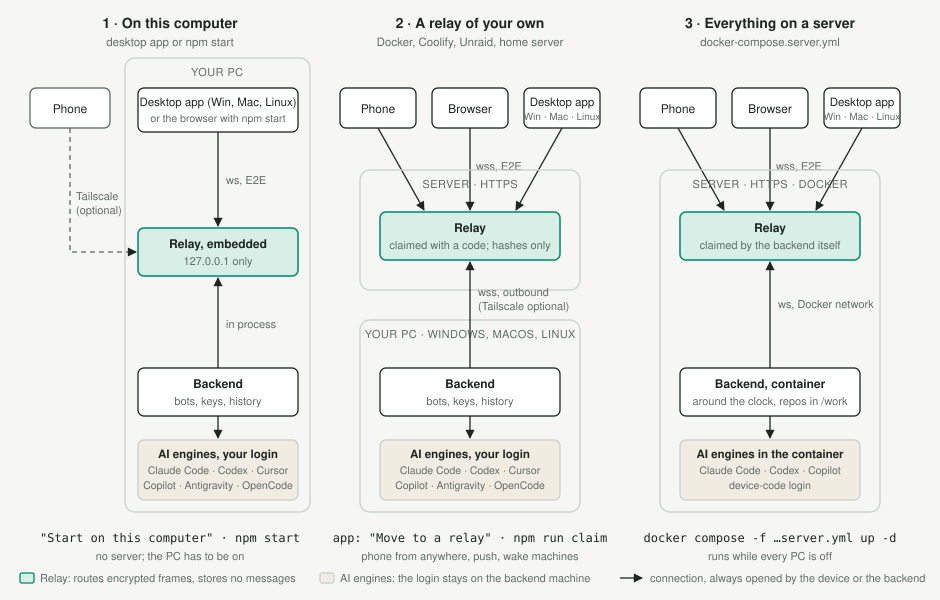

# OpenFolk (Deutsch)

Eine Web-App im Stil eines Messengers (fürs Handy gedacht), über die mehrere KI-Coding-Agenten auf den eigenen
Rechnern laufen. Jeder **Bot** ist ein Kollege mit eigenem Bild, Namen, Rolle, Ton und Modell und arbeitet fest in
einem Ordner, zum Beispiel ein Bot je Repository. Bots arbeiten weiter, wenn die App zu ist, und melden sich per
Push, wenn sie fertig sind oder eine Freigabe brauchen.

Standardmäßig laufen die Bots über das **Claude Agent SDK** (Claude Code). Ein Bot oder eine einzelne
Unterhaltung kann auch **OpenAI Codex** nutzen oder über das Agent Client Protocol (ACP) **Cursor**,
**GitHub Copilot**, **Google Antigravity** oder **OpenCode**. Die Oberfläche gibt es auf **Englisch und Deutsch**; deutsche
Browser bekommen automatisch Deutsch, umstellen lässt es sich in den Einstellungen.

Neben dem Browser (als PWA installierbar) gibt es Desktop-Apps für Windows, Linux und macOS (Electron,
`desktop/`) und Apps für iOS und Android (Capacitor, `mobile/`), alle um dieselbe Web-App herum.

<picture>
  <source media="(prefers-color-scheme: dark)" srcset="architecture-dark.svg">
  
</picture>

Das Relay sieht keine Zugangsdaten zu den Modellen und speichert keine Nachrichten. Das Backend verbindet sich
ausgehend, am Router wird nichts geöffnet. Die Ende-zu-Ende-Verschlüsselung ist ab dem ersten Start an, das Relay
sieht also nur das Routing.
Optional schränkt Tailscale die Verbindung des Backends weiter ein (`docs/tailscale.md`, englisch).

> **Stand:** frühe Open-Source-Version. Das Backend wird unter **Windows 11** entwickelt und getestet. Die
> Steuerung der Rechner ist einstellbar: Wecken per Wake-on-LAN, Weck-Dienst oder eigenem Befehl, Herunterfahren unter
> Windows, macOS und Linux; nur die automatische Anmeldung gibt es ausschließlich unter Windows. Das Relay läuft
> überall, wo Node 22 oder Docker läuft.

## Funktionen

- **Bots und Vorlagen.** Bot über „+“ anlegen, wahlweise aus einer Vorlage. Je Bot: Ordner, Modell, Freigabe-Stufe
  und Ton. „Vorschlag“ schlägt Namen (Vorname mit Aufgabenfeld in einem eigenen Feld), Rolle
  oder ein Profilbild vor; mit einem Gemini- oder OpenAI-Schlüssel in den Einstellungen
  ist der Avatar ein generiertes Foto, sonst ein vom Modell gezeichnetes SVG.
- **Freigaben im Chat.** Je Bot *riskant* (Standard: fragt bei Löschen, Push, Deploy, SSH, Dienst-Neustarts,
  Schreiben außerhalb des Ordners oder in Secrets, Secrets lesen per Shell, Pakete installieren, Code aus dem Internet
  ausführen, erhöhten Rechten; jeder Teil eines Shell-Befehls wird einzeln geprüft), *bei jeder Änderung* oder *nie*.
  *Riskant* ist ein sorgfältiger Filter, keine Mauer: Wer jeden Befehl bestätigen will, nimmt *bei jeder Änderung*.
  `.env`-Dateien und Schlüssel bekommen lesende Werkzeuge in keiner Stufe. Die Karte bietet Freigeben,
  Immer erlauben (für die Session) und Ablehnen mit Begründung; ohne Antwort wird nach 30 Minuten abgelehnt.
- **Rückfragen** eines Bots mit Optionen erscheinen als Karte mit Knöpfen und Freitext.
- **Push-Benachrichtigungen** je Art (Bot fertig, Routine fertig, Freigabe/Rückfrage, Rechner wach, Abo-Limit)
  aus, leise, normal oder hoch, für alle Geräte; einzelne Bots und Gruppen lassen sich in den Push-Einstellungen stummschalten. Browser
  bekommen Web Push (Ende-zu-Ende-verschlüsselt), die Mobile-Apps APNs bzw. FCM; dort sehen Apple und Google den
  Inhalt, deshalb zeigt eine App-Benachrichtigung standardmäßig nur den Titel (einstellbar in den Einstellungen).
- **Routinen** nach Zeitplan (täglich, werktags, wöchentlich, stündlich oder Cron), auf Wunsch mit Wecken des Rechners.
- **Gruppenchats** mit `@id` und `@all`; Bots können sich per @ weiterreichen.
- **Bot an Bot** über die Werkzeuge `message_bot` und `list_bots`; welche Bots einer erreicht, steht in seinen
  Einstellungen unter „Kann Aufträge geben an“ (alle, ausgewählte oder keinen).
- **Dateien** anhängen, einfügen oder hineinziehen; Bots schicken Dateien mit `send_file`.
- **Wissen:** Bots sammeln Fakten mit `remember_fact` und verwandten Werkzeugen, je Bot, Ordner, Gruppe oder für alle.
  Mit `search_history` und `read_history` durchsuchen sie außerdem den Verlauf aller Chats auf ihrem Rechner (ohne
  Werkzeugausgaben) und beantworten so Fragen nach früheren Entscheidungen. Weiteres Wissen (Wiki, Notion,
  Confluence) kommt über die MCP-Server, die du anbindest.
- **Sprachnachrichten,** lokal mit faster-whisper umgewandelt. Das ist der einzige, optionale Python-Teil: Mit Python 3.9
  oder neuer auf dem Rechner richtet „Sprachnachrichten einrichten“ in seinen Einstellungen den Rest ein
  (`local/tools/requirements-voice.txt`, auch von Hand). Die erste Sprachnachricht lädt das Modell, etwa 1,6 GB für
  `large-v3-turbo` (ohne Grafikkarte `small`, etwa 0,5 GB).
- **Gelesen-Stand, Favoriten und fixierte Nachrichten** gelten auf allen Geräten und Rechnern.
- **Spalten auf breiten Bildschirmen:** Strg-Klick (oder die mittlere Maustaste) öffnet einen Chat in einer eigenen
  Spalte daneben, so viele wie Platz haben; „+“ am rechten Rand fügt eine leere hinzu. Mit der Maus lässt sich ein
  Chat auch aus der Liste auf eine Spalte oder auf „+“ ziehen. Die Bot-Info dockt als eigene
  Spalte an. Handy und Laptop bleiben bei einem Chat.
- **Offene Änderungen** der Git-Repos im Ordner eines Bots, mit Committen und Pushen oder Holen je Repo.
- **Repos bleiben aktuell:** Beim Start, nach dem Aufwachen, alle 15 Minuten und nach einem Push aus der App auf
  einem anderen Rechner holt das Backend die Repos seiner Bots und spult saubere vor (nie Merge, Rebase oder Reset,
  nicht während ein Bot darin arbeitet). Was nicht geht, steht mit Grund unter „Offene Änderungen“. Ein Schalter in den
  Einstellungen schaltet es ab.
- **Arbeitsstand beim Rechnerwechsel:** Liegt Arbeit noch nicht auf dem Git-Server (nicht committete Änderungen, neue
  Dateien, nicht gepushte Commits), bietet der Bot-Editor an, sie mitzunehmen. Sie geht verschlüsselt über das Relay,
  ohne Push; der neue Rechner spielt ein, was sauber passt, und legt den Rest unter `.git/openfolk-work/` im Repo ab.
- **VS Code und Terminal:** Sessions aus VS Code oder dem Terminal mitlesen und als Unterhaltung übernehmen;
  „Diesen Chat in der IDE öffnen“ und „… im Terminal öffnen“ über der Liste übergeben die Session eines Chats an seinen
  Rechner, standardmäßig an VS Code (mit Claude Code für VS Code) oder an ein Terminal mit `claude --resume`; andere
  Befehle über `HANDOVER_IDE` und `HANDOVER_TERMINAL`, abschalten in den Einstellungen des Rechners. Läuft das Backend ohne Desktop (Windows-Aufgabe in Sitzung 0,
  Linux-Dienst), öffnet die Desktop-App in der angemeldeten Sitzung die Fenster für es.
- **Mehrere Rechner:** Auf jedem Rechner läuft dasselbe Backend, die Bots gibt es nur einmal. Jeder Bot wohnt auf
  einem Rechner und arbeitet dort in einem Ordner; schläft der Rechner, schläft der Bot, und die App bietet das
  Wecken an. Nichts weicht von selbst auf einen anderen Rechner aus. Rechner tauschen Arbeit wie Menschen über Git
  aus: Wird ein Projekt auf zwei Rechnern bearbeitet, hat jeder seinen Klon und seinen Bot. Beim Umzug eines Bots
  ziehen die Sessions mit dem ganzen Kontext mit, und der Bot-Editor klont das Repository auf den neuen Rechner,
  wenn es dort noch fehlt (im Feld „Ordner oder Repository“ steht dann die Adresse des Repositorys).
- **Einstellungen:** Sprache, Darstellung, Benachrichtigungen, Geräte und Sicherheit. Für alle Rechner: Bildmodell
  und API-Schlüssel für Profilbilder, Sprache der Sprachnachrichten, was App-Benachrichtigungen zeigen, Repos aktuell
  halten. Je Rechner (nur Hauptkonto): die KI-Anbieter, die dort laufen, jeder über sein Abo oder einen Schlüssel,
  Herunterfahren mit Countdown und Verhalten
  nach Weck-Routinen, Autologin, „In der IDE / im Terminal öffnen“, Sprachmodell. Ein Browser erfährt nur, ob ein
  Schlüssel hinterlegt ist; zu den anderen Rechnern reisen Schlüssel nur Ende-zu-Ende-verschlüsselt. Was Befehle
  ausführt oder eine Sicherheitsgrenze zieht (Skripte, Befehle, erlaubte Ordner), bleibt in der `.env`.

## Voraussetzungen

- Node 22.18 oder neuer und npm (nicht für die Desktop-Apps, die ihr eigenes mitbringen).
- Claude Code CLI mit Abo angemeldet (`claude` einmal starten) oder ein Anthropic-API-Schlüssel in den
  Einstellungen des Rechners.
  Bitte die Nutzungsbedingungen von Anthropic für das Abo beachten; für automatisierten oder geteilten Einsatz ist
  der API-Key-Modus die sichere Wahl.
- Optional: Codex, Cursor, Copilot oder Antigravity mit eigenem Login (siehe englisches README). OpenCode läuft ohne
  Login mit Gratis-Modellen; deren Anbieter dürfen die Daten fürs Training nutzen. API-Keys aus der Umgebung bekommt
  OpenCode nie.
- Jeder Anbieter meldet sich entweder über sein Abo oder mit einem Schlüssel an, der in den Einstellungen des Rechners
  unter „KI-Anbieter“ hinterlegt ist (OpenAI-API-Schlüssel für Codex, Cursor-API-Schlüssel, GitHub-Token mit
  Copilot-Zugriff, Gemini-API-Schlüssel für Antigravity). Schlüssel aus der Umgebung bekommt keine Engine. Dort
  abgeschaltete Anbieter startet der Rechner nicht; eine neue Installation hat alle abgeschaltet, bis man in den ersten
  Schritten die eigenen wählt.
- Claude kann auch beides: „Abo und API-Schlüssel, nach Regeln“ nutzt das Abo, bis es sein Limit meldet (oder schon
  Anthropics Warnung davor), dann den API-Schlüssel bis zum Reset, höchstens bis zu einem Tagesbudget in US-Dollar.
  Den Zug, den das Limit abgebrochen hat, startet die Sitzung mit dem Schlüssel neu.
- Optional: ein Host für das Relay mit HTTPS, für das Handy von überall und mehrere Rechner. Ohne läuft das Relay
  im Backend.
- Optional: Python 3 für die Spracherkennung; Android Studio bzw. Xcode für die Mobile-Apps
  (`mobile/README.md`, englisch, auch zur Einrichtung von APNs und FCM).

## Loslegen

Die Desktop-Apps für Windows, Linux (AppImage, .deb) und macOS bringen das Backend mit: beim ersten Start „Auf
diesem Rechner starten“ wählen, bei Claude Code anmelden, wenn die App danach fragt, fertig (`desktop/README.md`,
englisch). Sie kommen aus den [Releases](https://github.com/OpenFolk/OpenFolk/releases) und aktualisieren sich von dort
selbst. Aus dem Quellcode:

```sh
git clone https://github.com/OpenFolk/OpenFolk.git openfolk
cd openfolk
npm install
npm start
```

Das ist die ganze Einrichtung auf einem Rechner. Ohne `.env` startet das Backend das Relay im eigenen Prozess auf
`http://127.0.0.1:8787`, erzeugt beim ersten Start alle Schlüssel (`local/data/`) und öffnet die Web-App im Browser
mit einem Pairing-Link, der den Browser anmeldet und ihm den Ende-zu-Ende-Schlüssel übergibt. Danach führt die App
durch die ersten Schritte: Backend verbunden, KI-Anbieter wählen (eine neue Installation startet ohne, man hakt die
eigenen an) und bei einem anmelden (Claude Code in einem Terminal, das die App auf dem Rechner öffnet, oder mit einem
Anthropic-API-Schlüssel direkt im Schritt; Codex und Copilot mit einem Gerätecode, den man auf einem beliebigen Gerät
eingibt), erster Bot, Handy koppeln. Jeder Schritt hakt sich selbst ab.

```sh
npm run pair                          # Pairing-Link und QR-Code für ein weiteres Gerät (15 Minuten, einmalig)
node local/tools/e2e.mjs password     # Passwort der Web-App, nur ohne Pairing-Link nötig
```

Der Pairing-Link enthält den Ende-zu-Ende-Schlüssel. Das Backend zeigt ihn deshalb nur in einem interaktiven
Terminal, nie in einer Logdatei; als Dienst oder Container gestartet nennt es stattdessen `npm run pair`.

| Du willst | Weg |
| --- | --- |
| ausprobieren oder nur an diesem Rechner arbeiten | die Desktop-App („Auf diesem Rechner starten“) oder `npm start` |
| Handy von überall, Push, schlafende Rechner wecken | eigenes Relay auf einem Server, Backend auf dem PC |
| Bots, die laufen, während die PCs aus sind | Relay und Backend zusammen auf einem Server (`docker-compose.server.yml`) |

Weitere Rechner brauchen ein gemeinsames Relay. Am einfachsten in der App: Einstellungen, Rechner, „Rechner
hinzufügen“, dann auf dem neuen Rechner den Link in der Desktop-App einfügen („Diesen Rechner an meinen Server
anschließen“) oder nach `npm install` den angezeigten Befehl `npm run join -- "<Link>"` ausführen. Unter Windows
startet die Desktop-App ihr Backend auf Wunsch auch ohne Anmeldung („Auch ohne Anmeldung laufen“ im Tray-Menü), damit
ein geweckter Rechner sich von selbst meldet. Der Rechner bekommt ein eigenes Token und lässt sich in den Einstellungen wieder abmelden; die Schlüssel
kommen verschlüsselt von den anderen Rechnern. Von Hand: `npm run env` schreibt die erzeugten Werte (`E2E_KEY`,
`AGENT_TOKEN`, Push-Schlüssel) in die `.env` des ersten Rechners, die dann auf die anderen kopiert wird.
`E2E_KEY=off` schaltet die Verschlüsselung ab; dann kann der Relay-Host jeden Chat lesen. Codex und Copilot sind
optionale npm-Abhängigkeiten (etwa 600 MB); wer nur Claude nutzt, installiert mit `npm install --omit=optional`.

## Rechner-Einstellungen

Wecken, Herunterfahren und automatische Anmeldung stellt man über Umgebungsvariablen ein (alle mit Kommentar in
`.env.sample` bzw. für das Wecken in `relay/.env.sample`, Übersicht in `docs/running.md` unter „Machine settings“, englisch):

- **Wecken (Relay):** `WAKE_METHOD` = `wol` (Wake-on-LAN direkt vom Relay, Rechner in `WAKE_MACHINES` als
  `name=MAC`), `command` (eigener Befehl `WAKE_COMMAND` mit `{machine}` und `{mac}`), `service` (externer
  Weck-Dienst, `WAKEUP_URL` und `WAKEUP_API_TOKEN`) oder `none`. Vorlauf für Routinen: `WAKE_LEAD_SECONDS`.
- **Herunterfahren und Neustarten (je Rechner):** Wie, steht in der `.env`: ein Begleitskript (`SHUTDOWN_SCRIPT`),
  eigene Befehle (`SHUTDOWN_COMMAND`, `SHUTDOWN_CANCEL_COMMAND`, für „neu starten“ `SHUTDOWN_RESTART_COMMAND`) oder sonst
  der Befehl des Betriebssystems. Ob die App das darf, der Countdown und was nach Weck-Routinen passiert (herunterfahren,
  wenn niemand den Rechner nutzt, immer oder nie), stellt man in den Einstellungen des Rechners ein.
- **Automatische Anmeldung (Windows):** `AUTOLOGON_METHOD` = `script` (mit `AUTOLOGON_SCRIPT`) oder `none`.

**Relay als Container:** fertiges Image `ghcr.io/openfolk/openfolk:latest` (amd64 und arm64) mit einem Volume unter
`/data` und HTTPS davor. Ohne Tokens gestartet wartet es auf seinen Besitzer und schreibt einen Einrichtungscode
ins Log. Am einfachsten übernimmt man es aus der App: Solange ein Backend das Relay selbst betreibt, fragen die ersten
Schritte und die Einstellungen („Geräte und Sicherheit“, „Auf ein Relay auf einem Server umziehen“) nach Adresse und
Code; das Backend übernimmt das Relay, zieht ohne Neustart um, und die Seite folgt, dort angemeldet. Im Terminal geht
es mit `npm run claim -- https://relay.example.com <Code>` auf dem Rechner mit dem Backend; das übergibt dem Relay
die Tokens dieses Backends, trägt `RELAY_URL` in die `.env` ein, danach `npm run restart`. Das Relay
speichert nur Hashes (`/data/owner.json`). Wer die Werte selbst wählen will, setzt `USER_PASSWORD` und `AGENT_TOKEN`
(je mindestens 16 Zeichen). Mit Docker Compose reicht `docker compose up -d` im Hauptordner (Werte aus einer `.env`
daneben, gefüllt nach `relay/.env.sample`, nicht mit der `.env` des Backends). Hinter einem Reverse-Proxy im
Docker-Netz (Coolify, Traefik, nginx) bleibt `TRUST_PROXY` leer. In Coolify eine Ressource *Docker Image* mit Port
`8787`, Domain und einem Persistent Storage unter `/data` anlegen (der Code steht im Log der Anwendung), oder das
Repo mit Build-Pack *Docker Compose* einbinden. Details in `docs/running.md` (englisch).

**Relay und Backend auf einem Server:** `docker-compose.server.yml` startet beides. In einer `.env` daneben
`APP_URL` (die öffentliche HTTPS-Adresse des Relays) und `RELAY_SETUP_CODE` (beliebige 10 oder mehr Buchstaben und
Ziffern, etwa `openssl rand -hex 8`) setzen; das Backend beansprucht das Relay damit beim ersten Verbinden selbst.
Das erste Gerät braucht kein Terminal: Das Backend schreibt bei jedem Start einen Code in sein Log
(`docker compose -f docker-compose.server.yml logs local`), und die Anmeldeseite bietet „Code aus dem Server-Log“ an,
solange der Hauptzugang kein Gerät hat. Das Relay sieht den Code nie. Claude meldet sich mit einem
Anthropic-API-Schlüssel direkt in den ersten Schritten an, oder mit Abo über
`docker compose -f docker-compose.server.yml exec -u node local claude`; `… exec -u node local npm run pair` liefert
weiterhin einen Pairing-Link.

**Backend als Container (Linux):** ein Rechner, der nie schläft, etwa auf dem Server neben dem Relay. Bots können
dort wohnen und arbeiten rund um die Uhr, ihre Routinen laufen, ohne einen PC zu wecken.
Fertiges Image `ghcr.io/openfolk/openfolk-local`, Start mit `docker compose -f docker-compose.local.yml up -d` im
Hauptordner (Werte aus der `.env` daneben, dazu `MACHINE_NAME` als Name in der App; `RELAY_URL` ist hier Pflicht,
das Image hat kein eigenes Relay). Danach einmal
`docker compose -f docker-compose.local.yml exec -u node local claude` für die Claude-Anmeldung; Codex und Copilot
melden sich ebenso im Container an, Cursor und Antigravity werden ins Home-Volume installiert. Drei Orte halten
den Zustand: die Volumes `/home/node` (Anmeldungen) und `/data` (Bots, Verlauf, Wissen) und `/work` (die
Arbeitsordner der Bots; im Bot-Editor den Container als Rechner wählen und die Adresse des Repositorys ins Feld
„Ordner oder Repository“ eintragen; beim Speichern wird es dorthin geklont). `/work` ist ein Ordner des Servers (`WORK_DIR`, Vorgabe `./work` neben der Compose-Datei), damit man die
Ordner der Bots auch per SSH oder VS Code Remote erreicht.
Einzelheiten im englischen README.

Ohne Pairing-Link die Adresse des Relays öffnen und mit dem Passwort anmelden
(`node local/tools/e2e.mjs password`); die App fragt dann nach dem Schlüssel. Weitere Geräte koppelt man ohne Passwort über
einen Pairing-Link: auf einem angemeldeten Gerät in den Einstellungen unter „Geräte und Sicherheit“ „Weiteres Gerät koppeln“ wählen, den Link oder
QR-Code auf dem neuen Gerät öffnen (auf der Anmeldeseite liest „QR-Code scannen“ ihn mit der Kamera, in der App, im
Browser und in der Desktop-App; die App nimmt den Link auch im Adressfeld). Der Link gilt einmal und 15 Minuten und bringt den Ende-zu-Ende-Schlüssel mit. Umgekehrt geht es
auch: Die Anmeldeseite eines neuen Geräts zeigt selbst einen QR-Code; ein angemeldetes Gerät scannt ihn (Kamera oder
unter Geräte → „QR-Code scannen“), fragt mit Name und Adresse des neuen Geräts nach und meldet es dann an. Dauerbetrieb und mehrere Rechner beschreibt `docs/running.md` (englisch)
ausführlich.

## Konten

Ein Relay und seine Rechner können mehreren Personen oder Rollen dienen: dir bei der Arbeit und privat, einer
Kollegin, einem Konto je Kunde. Jedes Konto hat eigene Bots, Chats, Wissen, Geräte und eigene Anmeldungen bei Claude
und Codex, sodass Abos, Kontingente und Verbrauch getrennt bleiben, und es sieht nichts von den anderen. Wer das Relay
eingerichtet hat, besitzt das Hauptkonto; solange es kein zweites gibt, ändert sich nichts.

- **Anlegen:** Einstellungen → Konten → „Anlegen und einladen“. Die Einladung ist ein Kopplungslink mit QR-Code,
  15 Minuten gültig; wer ihn öffnet, ist im neuen Konto angemeldet. „Neue Einladung“ erzeugt eine weitere. Ein Konto
  kann sich danach ein eigenes Passwort setzen und sich dann mit Namen und Passwort anmelden. Admins verwalten Konten;
  das Hauptkonto ist immer einer.
- **Wechseln:** Ein Gerät kann in mehreren Konten angemeldet sein. Der Name neben dem Titel in der Seitenleiste
  wechselt zwischen ihnen, „Weiteres Konto anmelden“ fügt eines hinzu, und ein Einladungslink auf einem schon
  angemeldeten Gerät fügt sein Konto ebenfalls hinzu.
- **Eine Liste:** Die Chatliste zeigt die Bots aller Konten, in denen das Gerät angemeldet ist, die der anderen Konten
  mit dem Kontonamen als Abzeichen, mit dem, was sie gerade tun, ihrer letzten Nachricht und was neu ist. Ein Tipp
  öffnet den Chat in seinem Konto; Benachrichtigungen aller Konten kommen an. Einstellungen → „Bots aller Konten
  dieses Geräts in der Liste zeigen“ schaltet das für dieses Gerät ab.
- **KI-Anmeldungen je Konto:** Das Hauptkonto nutzt `~/.claude` und `~/.codex` des Rechners. Jedes andere Konto meldet
  sich je Rechner einmal in einem eigenen Ordner an: Codex mit einem Code aus der Einrichtungs-Checkliste, Claude mit
  dem Befehl, den die Checkliste zeigt (`CLAUDE_CONFIG_DIR=… claude`). Copilot, Cursor, Antigravity und OpenCode laufen nur für
  das Hauptkonto, weil sie eine zweite Anmeldung nicht getrennt halten, und der API-Schlüssel eines Rechners gilt
  nur für das Hauptkonto.
- **Was beim Besitzer bleibt:** die Einstellungen eines Rechners, Rechner herunterfahren und neu starten, die automatische Anmeldung und die
  VS-Code-Sitzungen gehören zum Hauptkonto. Bots aller Konten arbeiten in den Ordnern unter `ALLOWED_ROOTS` des
  Rechners, auf dem sie wohnen.
- **Löschen:** Ein Admin löscht ein Konto in derselben Liste. Seine Geräte werden sofort abgemeldet; auf jedem Rechner
  wandern seine Daten nach `local/data/deleted-accounts/`, ein Versehen lässt sich dort rückgängig machen.

## Sicherheit

Was der Betreiber des Relays kann und was nicht, mit Ende-zu-Ende-Verschlüsselung (Standard):

| Der Relay-Betreiber kann | Der Relay-Betreiber kann nicht |
| --- | --- |
| sehen, welche Geräte und Rechner wann und von welcher IP-Adresse verbunden sind | Chats, Dateien, Verlauf oder Wissen lesen |
| Größe und Zeitpunkt verschlüsselter Nachrichten sehen | einem Backend eigene Nachrichten schicken oder mitgeschnittene erneut zustellen |
| Nachrichten zurückhalten oder Browsern verändertes JavaScript ausliefern (den Mobile-Apps nicht) | deine Modell-Abos oder API-Schlüssel nutzen, sie verlassen deine Rechner nie |
| die Vorschau von App-Benachrichtigungen sehen, die es für Backends ohne eigene Apple- oder Google-Zugangsdaten zustellt | ein neues Gerät ohne Passwort, Pairing-Link oder (falls gesetzt) TOTP-Code anmelden |

- **Anmeldung:** Das Passwort braucht jedes Gerät einmal, danach meldet es sich mit einem eigenen Schlüssel an, von
  dem das Relay nur einen Hash kennt. Geräte lassen sich einzeln abmelden, unbenutzte verfallen nach 90 Tagen.
  Fehlversuche werden gebremst, TOTP ist optional.
- **Ende-zu-Ende-Verschlüsselung:** AES-256-GCM zwischen Browser und Backend und zwischen den Backends; jede
  Nachricht trägt Zähler und Sendezeit, das Relay kann nichts erneut zustellen. `E2E_KEY=off` schaltet ab, dann
  kann der Relay-Host jeden Chat lesen.
- **Dateien:** Die App bekommt Dateien nur aus den Bot-Ordnern und den Uploads, nie Geheimnisse (`.env`,
  Schlüssel), die Daten des Backends oder die Punktordner im Benutzerordner. Bots lesen `.env` und Schlüssel nicht.
- **Push an die Mobile-Apps** ist nicht Ende-zu-Ende-verschlüsselt: Apple und Google sehen den Titel (er nennt
  Bot, Gruppe oder Rechner); in den Einstellungen lässt sich das auf Titel und Text oder nur „OpenFolk“ ändern.
- Sicherheitslücken bitte vertraulich an security@openfolk.app melden, nicht in öffentlichen Issues (`SECURITY.md`).

## Entwicklung

```powershell
npm run typecheck     # tsc für Backend, Relay und Web-App
npm run lint          # oxlint
npm test              # Backend-, Relay- und Browser-Tests (Playwright, ohne Modellaufrufe)
npm run check         # alles nacheinander, wie die CI
node local/src/<name>.test.ts        # ein einzelner Backend-Test
node tests/browser/run.mjs <name>    # ein einzelner Browser-Test
```

Kein Build-Schritt: Node 22.18 oder neuer führt das TypeScript selbst aus, die Web-App sind ES-Module. Wer OpenFolk
ändert, liest zuerst `AGENTS.md` (englisch). Code, Kommentare und Commit-Nachrichten sind englisch, alle Texte für
Nutzer stehen deutsch und englisch in den Wörterbüchern.

## Lizenz

Copyright (C) 2026 Flowdesk GmbH.

OpenFolk steht unter der [MIT-Lizenz](../LICENSE). Nutzen, kopieren, ändern und weitergeben ist erlaubt, auch in
geschlossenen Produkten und gehosteten Diensten, solange Copyright-Hinweis und Lizenztext dabei bleiben. Ohne jede
Gewährleistung.

**Beiträge** stehen unter derselben MIT-Lizenz; eine eigene Vereinbarung braucht es nicht. Details in
[CONTRIBUTING.md](../CONTRIBUTING.md).
